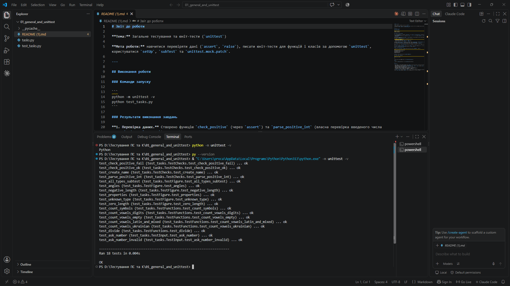

# Звіт до роботи

**Тема:** Загальне тестування та юніт-тести (`unittest`)

**Мета роботи:** навчитися перевіряти дані (`assert`, `raise`), писати юніт-тести для функцій і класів за допомогою `unittest`, користуватися `setUp`, `subTest` та `unittest.mock.patch`.

---

## Виконання роботи

### Команди запуску

```
python -m unittest -v
python test_tasks.py
```

### Результати виконання завдань

**1. Перевірка даних.** Створено функцію `check_positive` (через `assert`) та `parse_positive_int` (власна перевірка введеного числа через `raise ValueError`).
Правильне введення `"7"` повертає `7`; неправильне (`"abc"`, `""`, `"0"`, `"-3"`) викликає `ValueError`, а `check_positive(-1)` — `AssertionError`.

**2. Тестування функцій.** Для `count_symbols` та `divide` написано тести на звичайні, порожні та граничні дані; для `divide(1, 0)` перевіряється `ZeroDivisionError`.

**3. Функція `count_vowels`** (кількість голосних літер) і тести для:
- порожнього рядка (`""` → 0),
- рядка з цифрами (`"12345"` → 0),
- рядка з українськими літерами (`"Привіт"` → 2, `"ЄЇІ"` → 3),
- змішаного та латинського рядка (`"а1б2е3"` → 2, `"Hello"` → 2).

**4. Клас `Figure`** (`квадрат`, `прямокутник`, `трикутник`): методи `get_figure_type`, `get_figure_length`, `get_angles` (квадрат і прямокутник — `[90, 90, 90, 90]`, трикутник вважаємо рівностороннім — `[60, 60, 60]`).
Тести: властивості, кути, нульова довжина, від'ємна довжина, невідомий тип (усі випадки → `ValueError`).

**5. `subTest`.** Тест `test_all_types_subtest` перевіряє всі типи фігур з довжинами 1, 5, 10; якщо впаде один набір, буде видно, який саме.

**6. `patch`.** Функція `ask_number()` читає число через `input()`. У тесті `input` підмінено на `"5"`, тому вводити нічого вручну не потрібно, а `mock_input.assert_called_once()` перевіряє, що `input` викликався.

### Тест, який спочатку не проходив

У першій версії `count_vowels` у `VOWELS` були лише латинські голосні (`"aeiouAEIOU"`). Результат:

```
FAIL: test_count_vowels_latin_and_mixed
AssertionError: 0 != 2
FAIL: test_count_vowels_ukrainian
AssertionError: 0 != 2
Ran 18 tests in 0.002s
FAILED (failures=2)
```

Виправлення: додано українські голосні `"аеєиіїоуюяАЕЄИІЇОУЮЯ"`.

### Результат після виправлення

```
Ran 18 tests in 0.001s

OK
```



### Код

Повний код: [tasks.py](tasks.py), тести: [test_tasks.py](test_tasks.py).

---

## Висновок

- **Що зроблено в роботі:** написано функції та клас `Figure`, а також 18 юніт-тестів до них, перевірено помилкові дані.
- **Чи досягнуто мети роботи:** так, усі тести проходять (`OK`).
- **Які нові знання отримано:** `assertEqual`, `assertRaises`, `setUp`, `subTest`, `patch` для підміни `input`.
- **Чи вдалось відповісти на всі питання, задані в ході роботи:** так.
- **Чи виникли складності у виконанні завдання:** так, невеликі: спочатку не запускалась команда `python` у терміналі, довелося запускати Python за повним шляхом. Також потрібно було розібратися, як працює `patch` для підміни `input()`.
- **Чи подобається такий формат здачі роботи (Feedback):** так, зручно оформлювати звіт у Markdown на GitHub: код, результати тестів і скріншоти зберігаються в одному місці, а посилання легко здати.
- **Побажання для покращення (Suggestions):** додати в конспект короткий опис того, як запускати Python на Windows, і більше прикладів з `patch` та `subTest`.

**`subTest` та `mock` у власному прикладі:** `subTest` дозволяє в одному тесті перевірити багато наборів даних і побачити, який саме не пройшов. `mock` (`patch`) підмінює `input()`, щоб тест не залежав від того, що вводить користувач.
