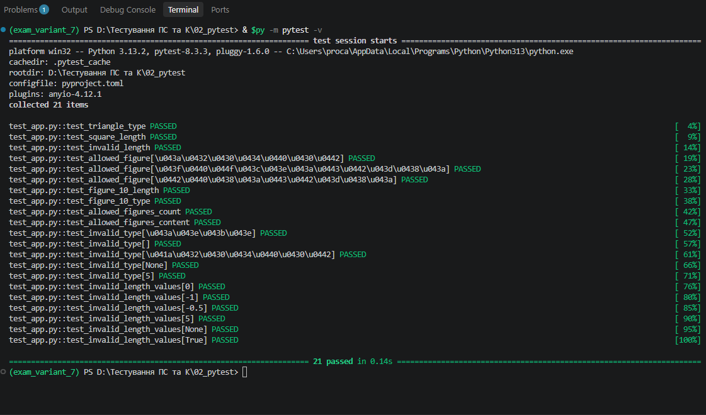
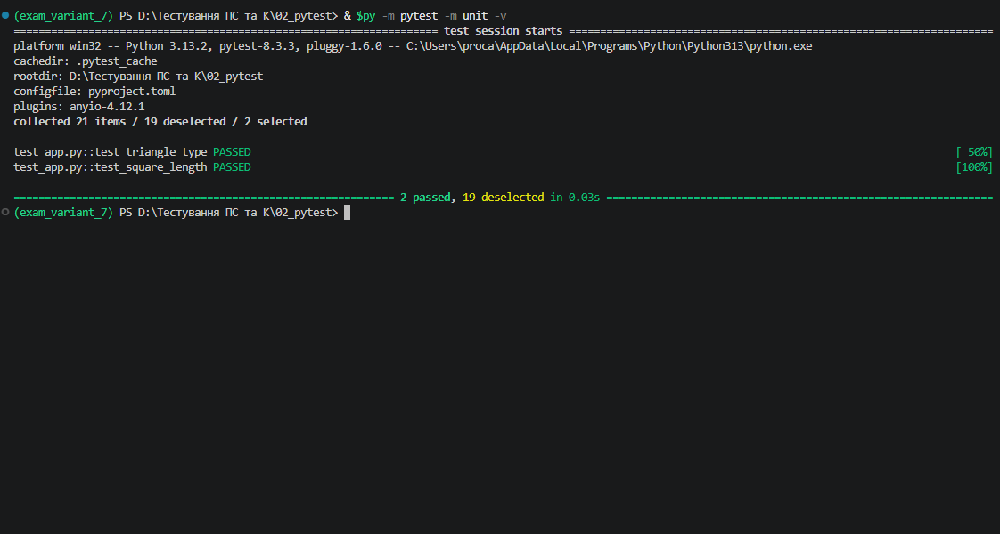
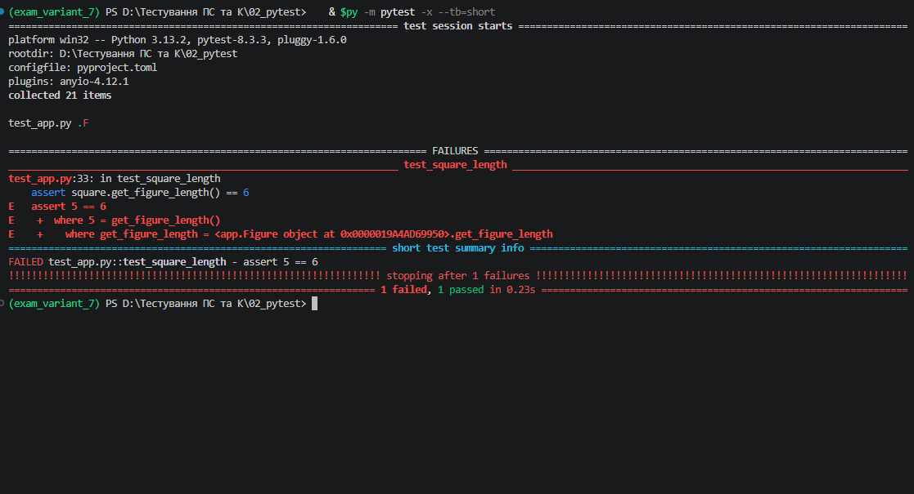

# Звіт до роботи

**Тема:** Тестування з використанням бібліотеки `pytest`

**Мета роботи:** навчитися писати тести за допомогою `pytest`: прості `assert`, перевірка винятків, параметризація, fixtures, маркери.

---

## Виконання роботи

### Встановлення та команди запуску

```
pip install pytest
pytest -v
pytest -m unit -v
pytest --collect-only
pytest -x --tb=short
```

### Результати виконання завдань

**1. Основи.** Створено клас `Figure` (`app.py`) з типами `квадрат`, `прямокутник`, `трикутник` і перевіркою даних через `assert`. Тести: `test_triangle_type` (властивість `type`) та `test_invalid_length` (`pytest.raises(AssertionError)` для довжини 0).

**2. Параметризація.** Тест `test_allowed_figure` з `@pytest.mark.parametrize("figure", Figure.FIGURES)` перевіряє всі три дозволені фігури одним тестом.

**3. Fixture `figure_10`.** Повертає фігуру з довжиною 10; тести `test_figure_10_length` і `test_figure_10_type` перевіряють її властивості. Також є fixture `square`, яку використовує `test_square_length`.

**4. Неправильні дані (🔥).** `test_invalid_type` перевіряє типи `"коло"`, `""`, `"Квадрат"`, `None`, `5`. `test_invalid_length_values` перевіряє довжини `0`, `-1`, `-0.5`, `"5"`, `None`, `True`. У всіх випадках очікується `AssertionError`.

**5. Маркер `unit`.** Маркер додано до двох тестів (`test_triangle_type`, `test_square_length`) і зареєстровано в `pyproject.toml`. Команда `pytest -m unit -v` запускає лише їх.

**6. Fixture зі `scope="module"`.** Fixture `allowed_figures` створюється один раз на модуль і використовується у двох тестах: `test_allowed_figures_count` та `test_allowed_figures_content`.

### Результат запуску `pytest -v`



### Запуск тільки тестів з маркером `unit`



### Навмисно зламаний тест (🔥)

У тесті `test_square_length` очікуване значення змінено з `5` на `6` і запущено `pytest -x --tb=short`:



**Пояснення:** тест впав, бо `square.get_figure_length()` повертає `5`, а очікувалось `6` (рядок `assert 5 == 6`). Параметр `-x` зупинив запуск після першої помилки, тому наступні тести не виконувались. Параметр `--tb=short` скоротив traceback до одного-двох рядків з місцем помилки. Після повернення значення `5` усі тести знову проходять.

### Код

Код: [app.py](app.py), тести: [test_app.py](test_app.py), налаштування: [pyproject.toml](pyproject.toml).

### Різниця між тестом `unittest.TestCase` та функцією `pytest`

У `unittest` тест — це метод класу, який наслідує `unittest.TestCase`, а перевірки роблять спеціальними методами (`assertEqual`, `assertRaises`), підготовка робиться через `setUp`/`tearDown`. У `pytest` тест — це звичайна функція з іменем `test_...`, перевірка робиться простим `assert` (pytest сам показує, чому він не виконався), а підготовка даних виконується через fixtures. Також у `pytest` є зручні `parametrize` та маркери.

### Приклад параметризації

```python
@pytest.mark.parametrize("figure", Figure.FIGURES)
def test_allowed_figure(figure):
    assert Figure(figure, 1).type == figure
```

Один тест виконується тричі: для `квадрат`, `прямокутник` і `трикутник`.

---

## Висновок

- **Що зроблено в роботі:** написано клас `Figure` і тести до нього з використанням `assert`, `pytest.raises`, параметризації, fixtures і маркерів.
- **Чи досягнуто мети роботи:** так, усі тести проходять.
- **Які нові знання отримано:** `parametrize`, fixtures (зокрема `scope="module"`), маркери та запуск `pytest -m`, `-x`, `--tb=short`.
- **Чи вдалось відповісти на всі питання, задані в ході роботи:** так.
- **Чи вдалося виконати всі завдання:** так.
- **Чи виникли складності у виконанні завдання:** так, невеликі: після завантаження файлів до назв додалося `(1)`, через що `pytest` не знаходив модуль `app`, тому файли довелося перейменувати. Також команда `python` не запускалась у терміналі, і для запуску `pytest` довелося використовувати повний шлях до `python.exe`.
- **Чи подобається такий формат здачі роботи (Feedback):** так, зручно, що код, тести, скріншоти запуску та пояснення зберігаються в одному репозиторії на GitHub, а для здачі достатньо одного посилання.
- **Побажання для покращення (Suggestions):** додати в конспект короткий опис того, як запускати `pytest` на Windows, якщо команда `python` не працює, а також більше прикладів використання маркерів і fixtures з різними `scope`.
