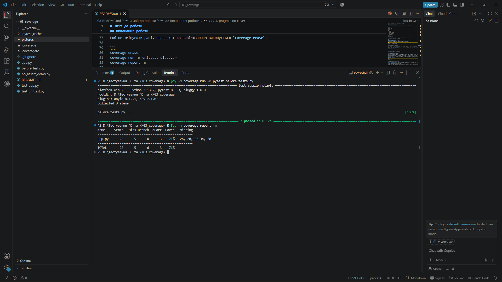
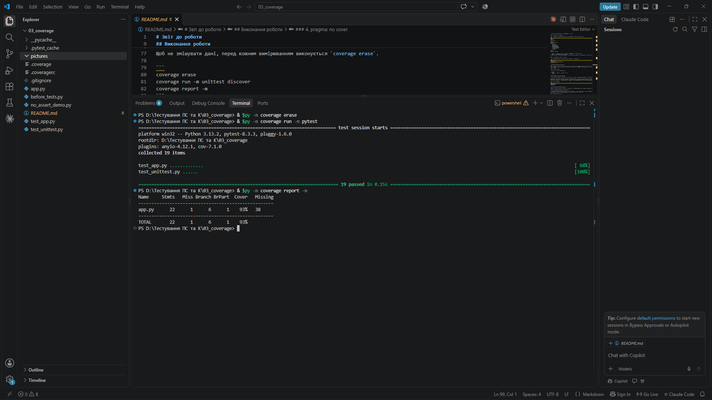
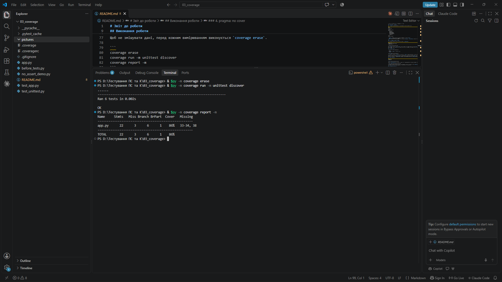
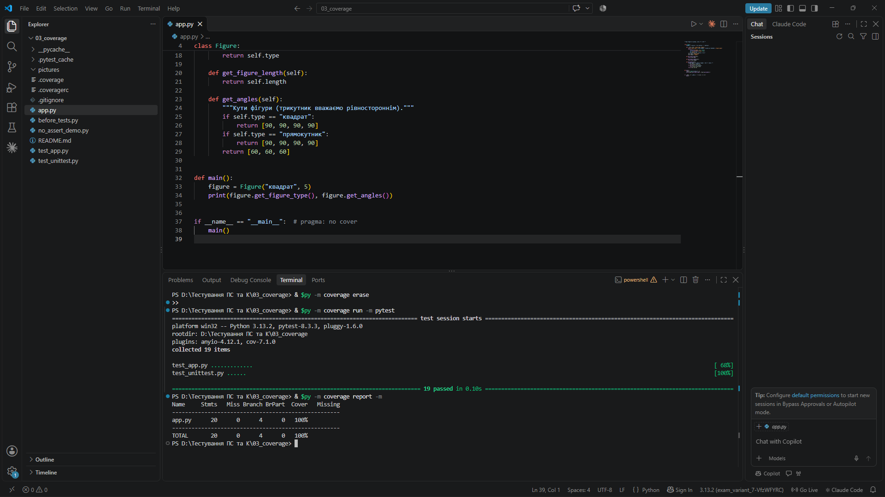
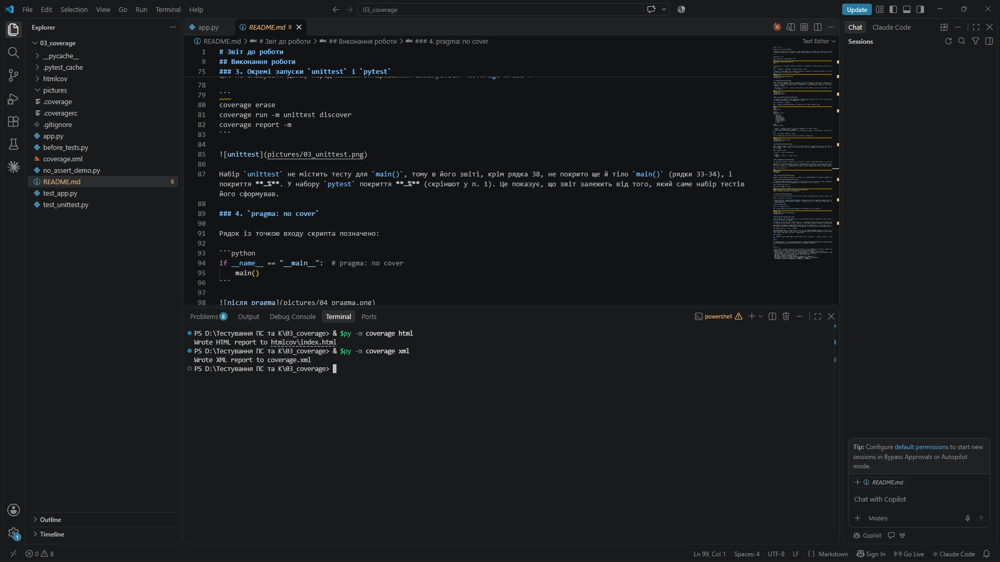
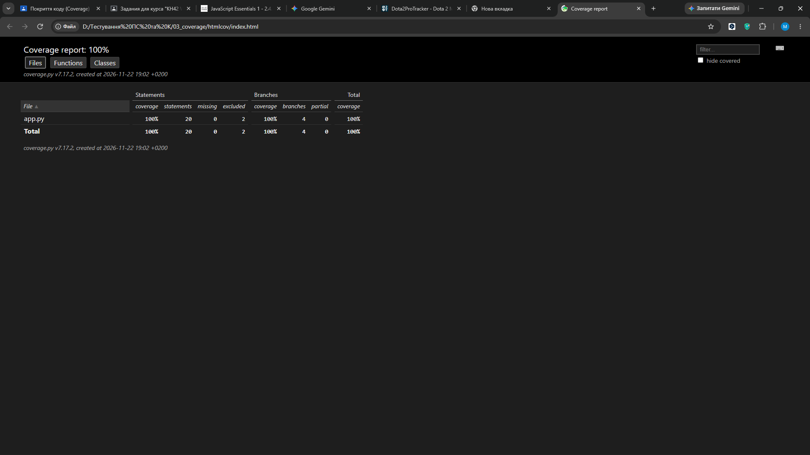
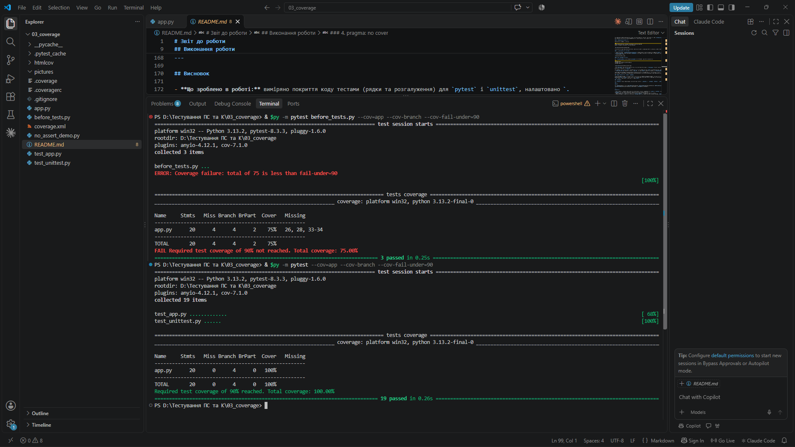
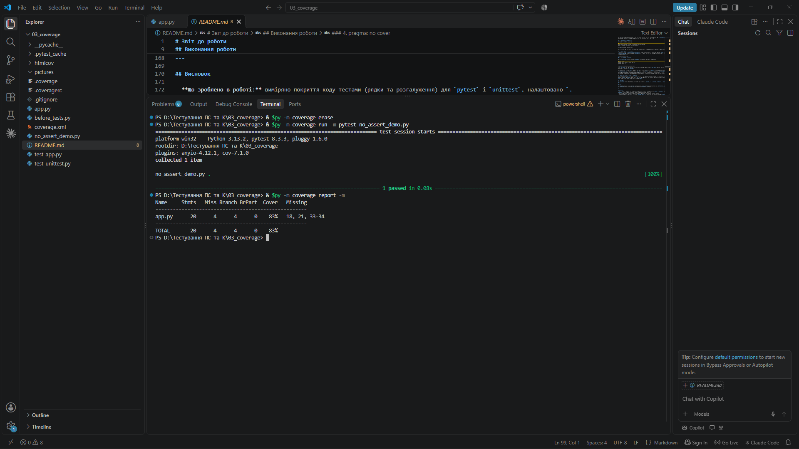

# Звіт до роботи

**Тема:** Покриття коду (Coverage)

**Мета роботи:** навчитися вимірювати покриття коду тестами за допомогою `coverage.py` та `pytest-cov`, читати звіт (рядки та розгалуження), налаштовувати `.coveragerc`, задавати мінімальний поріг покриття і розуміти, чого саме покриття не доводить.

---

## Виконання роботи

### Встановлення та команда запуску тестів

```
pip install coverage pytest pytest-cov
pytest -v
```

Покриття вимірюється командами `coverage run -m pytest` та `coverage run -m unittest discover`, а звіт виводиться командою `coverage report -m`.

### 1. Розгалуження в `get_angles` (до і після додавання тестів)

У `app.py` метод `get_angles` має три гілки: для квадрата, прямокутника і трикутника. Спочатку покриття виміряно для початкового набору `before_tests.py`, у якому є лише тест трикутника:

```
coverage erase
coverage run -m pytest before_tests.py
coverage report -m
```



**Які рядки були пропущені до змін:** не виконувались `return` для квадрата (рядок 26) і для прямокутника (рядок 28), тому що жоден тест не створював такі фігури та не викликав `get_angles`. Також не виконувалось тіло `main()` (рядки 33-34) і виклик `main()` під `if __name__ == "__main__":` (рядок 38). Для умов `if self.type == ...` були пройдені не всі напрямки, тому в звіті з'явились часткові розгалуження (`BrPart`).

Потім додано тести для всіх трьох фігур (`test_get_angles` з параметризацією, а також `test_main_output`, що перевіряє виведення `main()` через `capsys`):

```
coverage erase
coverage run -m pytest
coverage report -m
```



**Порівняння:** до змін покриття було **…%**, після — **…%**. Тепер у `Missing` лишився тільки рядок 38 (`main()` під `if __name__`), бо модуль у тестах імпортується, а не запускається як скрипт.

### 2. Налаштування `.coveragerc`

Файл `.coveragerc` зберігає налаштування, щоб не передавати їх щоразу в командному рядку:

```
[run]
source = .
branch = true

[report]
show_missing = true
omit =
    test_*.py
    */test_*.py
    before_tests.py
    */before_tests.py
    no_assert_demo.py
    */no_assert_demo.py
    */__init__.py
    */.venv/*

[html]
directory = htmlcov
```

- `source = .` означає, що вимірюється код у поточній папці, тому в звіті є `app.py`;
- `branch = true` вмикає покриття розгалужень;
- `omit` виключає тести та допоміжні файли, тому в звіті немає `test_app.py`, `test_unittest.py` та інших тестових файлів, лише `app.py`.

### 3. Окремі запуски `unittest` і `pytest`

Щоб не змішувати дані, перед кожним вимірюванням виконується `coverage erase`.

```
coverage erase
coverage run -m unittest discover
coverage report -m
```



Набір `unittest` не містить тесту для `main()`, тому в його звіті, крім рядка 38, не покрито ще й тіло `main()` (рядки 33-34), і покриття **…%**. У набору `pytest` покриття **…%** (скріншот у п. 1). Це показує, що звіт залежить від того, який саме набір тестів його сформував.

### 4. `pragma: no cover`

Рядок із точкою входу скрипта позначено:

```python
if __name__ == "__main__":  # pragma: no cover
    main()
```



**Порівняння:** до позначки в `Missing` був рядок 38, покриття `pytest` — **…%**; після позначки рядок зник, покриття — **…%**.

**Чому використано:** це стандартна точка входу, у якій немає ні умов, ні обчислень, лише виклик `main()`. Сама функція `main()` перевіряється окремим тестом `test_main_output`, тому виключення не приховує жодної важливої логіки, а покриття `get_angles` та конструктора не змінюється. Позначка не використовувалась, щоб штучно підвищити відсоток: тіло `main()` залишається у вимірюванні.

### 5. HTML- та XML-звіти

```
coverage html
coverage xml
```



HTML-звіт `htmlcov/index.html` відкривається в браузері, на сторінці файлу підсвічено виконані та пропущені рядки:



**Призначення:** HTML призначений для людини, щоб швидко побачити, які саме рядки не покрито. XML (`coverage.xml`) призначений для інструментів: CI-систем і сервісів аналізу покриття, які автоматично читають цей формат.

### 6. Мінімальний поріг покриття

Власний поріг: **90%**. Перевірка:

```
pytest before_tests.py --cov=app --cov-branch --cov-fail-under=90
pytest --cov=app --cov-branch --cov-fail-under=90
```



Для початкового набору перевірка не проходить (поріг не досягнуто, команда завершується з помилкою), після додавання тестів — проходить.

### 7. Перевірка покриття в CI (🔥)

У репозиторії додано `.github/workflows/coverage.yml`: GitHub Actions встановлює залежності, запускає `pytest --cov=app --cov-branch --cov-fail-under=90`, а також зберігає `coverage.xml` як артефакт. Якщо покриття нижче 90%, крок завершується помилкою і workflow отримує невдалий статус.


### 8. Чого coverage не доводить

Тест `no_assert_demo.py` лише викликає `get_angles` для всіх фігур, але нічого не перевіряє:

```
coverage erase
coverage run -m pytest no_assert_demo.py
coverage report -m
```



Рядки `get_angles` (26, 28, 29) стали покритими, хоча жодної перевірки немає. У `test_app.py` ті самі рядки покриті, але ще й перевіряється значення (`== expected`).

**Що змінилось:** тест без `assert` гарантує лише те, що код не падає. Тест із `assert` гарантує правильний результат. Наприклад, якби в `return [60, 60, 60]` помилково з'явилось `[60, 60]`, тест без `assert` залишився б зеленим, а `test_get_angles` упав би.

**Чому 100% line coverage не означає відсутності помилок:** покриття показує лише, що рядок виконався, а не що результат правильний. Воно не знає, чи перевірені всі вхідні дані (граничні значення), і не виявляє відсутній код або неправильні вимоги.

### Різниця між покриттям рядків і розгалужень

**Line coverage** показує, чи виконався кожен рядок хоча б раз. **Branch coverage** показує, чи пройшли тести кожен напрямок умовного переходу (і `True`, і `False`). Тому рядок з `if` може бути «покритим», але частково: наприклад, якщо умова завжди була хибною, гілка `True` лишається непройденою, і це видно в стовпці `BrPart`.

### `.gitignore`

До `.gitignore` додано службові файли, які не потрібно комітити: `__pycache__/`, `.coverage`, `htmlcov/`, `.pytest_cache/` та `coverage.xml`.

### Код

Код: [app.py](app.py), тести: [test_app.py](test_app.py), [test_unittest.py](test_unittest.py), [before_tests.py](before_tests.py), [no_assert_demo.py](no_assert_demo.py), налаштування: [.coveragerc](.coveragerc).

---

## Висновок

- **Що зроблено в роботі:** виміряно покриття коду тестами (рядки та розгалуження) для `pytest` і `unittest`, налаштовано `.coveragerc`, створено HTML- і XML-звіти, задано поріг покриття та перевірку в CI.
- **Чи досягнуто мети роботи:** так, покриття виміряно, пропущені рядки знайдено й покрито тестами.
- **Які нові знання отримано:** як читати звіт `coverage report -m`, різниця між line та branch coverage, `pragma: no cover`, `--cov-fail-under`, і те, що відсоток покриття не гарантує правильність результату.
- **Чи вдалось відповісти на всі питання, задані в ході роботи:** так.
- **Чи вдалося виконати всі завдання:** так.
- **Чи виникли складності у виконанні завдання:** так, невеликі: при завантаженні файлів зникла крапка в назвах `.coveragerc` і `.gitignore`, через що налаштування не підхоплювалися, їх довелося перейменувати. Також команда `python` не запускалась у терміналі, тому використовувався повний шлях до `python.exe`.
- **Чи подобається такий формат здачі роботи (Feedback):** так, зручно, що код, тести, скріншоти та пояснення зберігаються в одному репозиторії на GitHub, а для здачі достатньо одного посилання.
- **Побажання для покращення (Suggestions):** додати в конспект приклад запуску `coverage` без `poetry` (через `python -m coverage`) і пояснення, чим відрізняються покриття рядків і гілок на простому прикладі.
